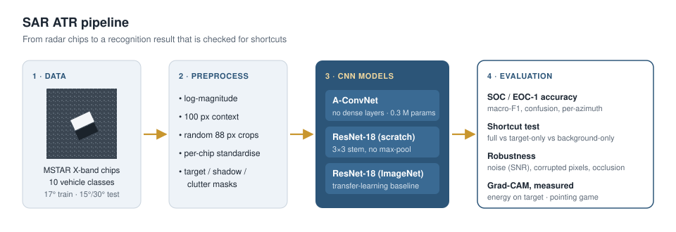

# SAR Target Recognition with CNNs

Automatic target recognition on MSTAR synthetic aperture radar images, with a focus on a question that accuracy alone does not answer: is the network recognising the vehicle, or the ground around it?

## Motivation

CNNs reach close to perfect accuracy on MSTAR, the standard public SAR benchmark. However, every vehicle in MSTAR was recorded at a particular site, so the clutter around a target is correlated with its class, and it has been reported that the background alone can be enough to classify the images. This project measures how much of a model's accuracy actually comes from the target.

## Approach

- Models: A-ConvNet (all-convolutional, about 0.3 M parameters) trained from scratch, and ResNet-18 trained from scratch and from ImageNet weights.
- Protocols: SOC (10 classes, train at 17°, test at 15° depression) and EOC-1 (large depression change, test at 30° and 45°).
- Validation comes from the training angle only, so the test angle is never used for model selection.
- Shortcut test: each chip is split into target, shadow and clutter. Models are evaluated on target-only and background-only chips, and one model is trained and tested without ever seeing the target. The removed region is a fixed box filled with clutter-like noise, so its outline cannot reveal the vehicle size.
- Robustness: noise at decreasing SNR, randomly corrupted pixels and partial occlusion of the target.
- Explainability: Grad-CAM, evaluated with numbers (share of the heat map on the target, pointing game) and not only with example images.

The full experiment design is in [docs/DESIGN.md](docs/DESIGN.md).

## Progress

- [x] Reader for raw MSTAR files and converted image chips
- [x] SOC and EOC-1 protocols with validation from the training angle only
- [x] A-ConvNet and ResNet-18 models
- [x] Shortcut test with target / shadow / clutter masking
- [x] Robustness curves (noise, corrupted pixels, occlusion)
- [x] Grad-CAM localisation metrics
- [x] Unit tests and an end-to-end test on synthetic data with injected background bias
- [x] Colab notebook

Next:

- [ ] SOC and EOC-1 experiments on MSTAR
- [ ] Shortcut test on MSTAR

## Code

The implementation (data handling, models, training and analysis scripts, tests and a Colab notebook) is kept in a private repository for now. I am happy to share it on request.

## Data

MSTAR public release, Sensor Data Management System, U.S. Air Force Research Laboratory. The data is not redistributed here.

## References

- S. Chen, H. Wang, F. Xu, Y.-Q. Jin. Target Classification Using the Deep Convolutional Networks for SAR Images. IEEE TGRS, 2016.
- R. Schumacher, K. Rosenbach. ATR of battlefield targets by SAR: classification results using the public MSTAR dataset compared with a dataset by QinetiQ UK. NATO RTO-MP-SET-080, 2004.
- C. Belloni, N. Aouf, A. Balleri et al. Explainability of deep SAR ATR through feature analysis. IEEE Transactions on Aerospace and Electronic Systems, 2021.
